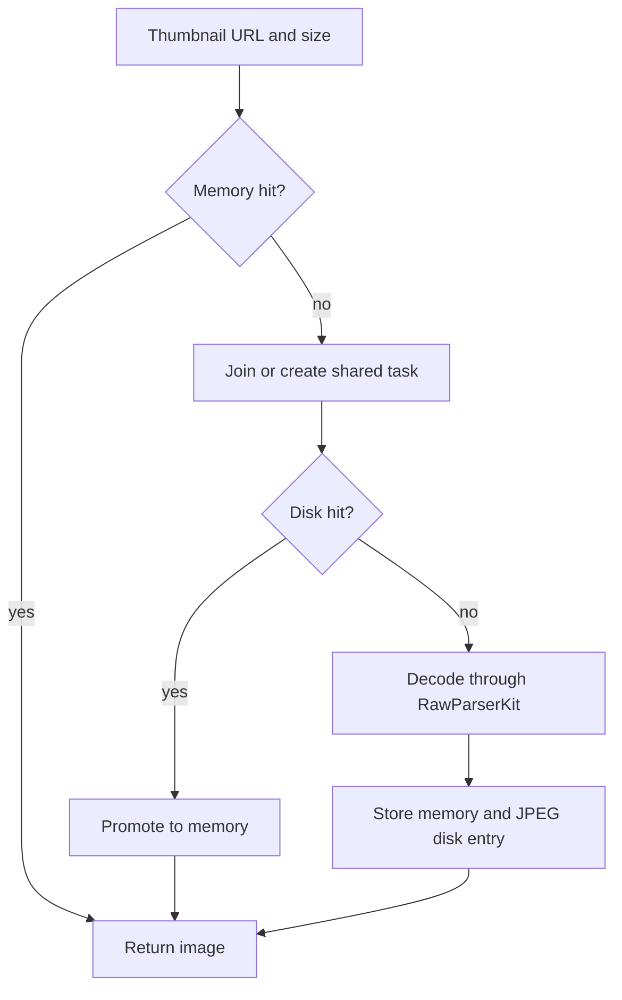

# RawBrowse developer and API documentation

Last reviewed: 2026-10-17. Scope: the checked-in macOS application and its internal Swift interfaces.

Read this guide in order to follow a photograph from application launch through folder browsing, preview, optional AI review, RAW 9 editing and export. The operation reference describes inputs, results, ownership and failure behavior. Links are relative to this document and point to the implementation in this checkout.

“API” here means the application’s internal Swift interfaces. These workflows do not expose an HTTP server or REST endpoints, and the app types are not a versioned public SDK. A synchronous action often launches owned asynchronous work: returning from that action is not proof that scanning, inference, persistence or export has finished. Inspect the documented observable state or await the relevant completion operation.

## Reading guide

1. [Normal flow of operation](#normal-flow-of-operation)
2. [Developer setup](#developer-setup)
3. [Architecture and ownership](#architecture-and-ownership)
4. [Main operation API reference](#main-operation-api-reference)
5. [RAW 9 operations](#raw-9-operations)
6. [Persistence and cache layout](#persistence-and-cache-layout)
7. [Errors and recovery](#errors-and-recovery)
8. [Testing and maintenance](#testing-and-maintenance)

## Normal flow of operation

### 1. Launch assembles a shared workspace

[RawBrowseApp.swift](../RawBrowse/Main/RawBrowseApp.swift) retains one `FileBrowserViewModel` in application state. The Image Browser, AI Workspace and Settings scenes receive this same workspace through [BrowserWorkspaceEnvironment.swift](../RawBrowse/Main/BrowserWorkspaceEnvironment.swift). Opening another scene therefore uses the existing settings, selection, catalog and model runtimes.

[FileBrowserViewModel.swift](../RawBrowse/Main/FileBrowserViewModel.swift) is the composition root. It creates or accepts feature owners, wires callbacks and coordinates operations that cross feature boundaries. It does not implement decoding or inference itself.

The main window task installs the termination callback and calls `loadIfNeeded()`. Initialization proceeds in this order:

1. Load settings and apply the image-memory configuration.
2. Restore remembered catalog roots and security-scoped bookmarks.
3. Refresh managed AI model locations. The location callback activates CLIP and SAM 3.
4. Request CLIP index validation for remembered roots.
5. Select the first restored root if no folder is selected.

`loadIfNeeded()` retains its startup task so repeated callers await the same startup. Some work, including model validation and folder scanning, is launched by these steps and completes afterward. Successful startup does not imply that every AI capability is already ready.

### 2. Adding a folder establishes access and a remembered root

The folder-picker action calls `FileBrowserViewModel.addRootFolder(_:)`. [CatalogStore.swift](../RawBrowse/Features/Browser/CatalogStore.swift) standardizes the URL, opens security-scoped access, adds the root if needed and schedules folder discovery. It also creates a bookmark and queues persistence of the remembered roots.

[CatalogAccess.swift](../RawBrowse/Infrastructure/CatalogAccess/CatalogAccess.swift) separates a catalog session from the work using it. A `CatalogAccessLease` balances one successful security-scope start with a stop at deinitialization. Workers retain the same lease. Removing the session’s reference does not revoke access still retained by an image load or save.

For a nested folder, access resolves to the deepest matching remembered root. A plain URL describes a location; retaining the matching lease preserves the grant while asynchronous work uses that location.

On restoration, unavailable roots remain in the persisted collection. A disconnected drive must not silently erase its remembered entry. A corrupt catalog file blocks ordinary saves until loading succeeds, preserving the existing file.

### 3. Selecting a folder admits a transition before scanning

Use `selectFolder(_:)`, rather than assigning folder or file state directly. The action rejects transitions during shutdown, while sidebar selection is disabled, or when access cannot be opened. A rejected access request populates `folderAccessFailure` with a retryable operation.

An admitted transition cancels refresh and Deep Review work, closes zoom, resets the zoom interface, clears selection and semantic results, and starts a new contents scan with a retained access lease. It then selects the CLIP catalog using the root access URL. Thus a nested folder’s grid can use its enclosing catalog’s recursive search index.

[BrowserContentsModel.swift](../RawBrowse/Features/Browser/BrowserContentsModel.swift) clears old files, sets `isScanning`, and runs folder and file discovery concurrently. A `LatestTaskRunner` token prevents obsolete scans from publishing results after a newer scan starts. On success it publishes children and files; on failure it publishes `scanError`.

[BrowserImageLoader.swift](../RawBrowse/Infrastructure/ImageLoading/BrowserImageLoader.swift) discovers immediate, visible regular files whose extensions belong to `RawFormatRegistry.allExtensions` or the app’s rendered-image extensions. Results use localized filename order. Normal grid discovery is not recursive. Sidebar expansion discovers children separately.

`BrowserFileItem` contains a URL, display name and newly generated UUID. It does not eagerly contain EXIF, decoded pixels or saved editing state. A rescan creates new UUIDs, so refresh preserves surviving selections by standardized URL rather than old item IDs.

### 4. The grid displays the active projection

The composition root chooses `contents.files` for ordinary browsing and `clip.semanticFiles` while semantic or similarity search is active. [SelectionModel.swift](../RawBrowse/Features/Browser/SelectionModel.swift) owns the resulting `displayedFiles`, the primary selected ID and the multiple-selection set.

| State | Meaning |
|---|---|
| `contents.files` | Supported files in the selected folder’s immediate contents. |
| `selection.displayedFiles` | Current grid/navigation order, including search results when active. |
| `selection.selectedFileID` | Primary focused item in that projection. |
| `selection.selectedFileIDs` | Explicit multiple-selection IDs. |
| `selection.selectedFiles` | Selected items in displayed order. |
| `clip.semanticSearchResults` | Ranked search evidence, including scores and paths. |

Replacing displayed files prunes IDs no longer present. Scan completion and completed search publication can select the first item. Range selection uses an anchor; keyboard navigation moves within displayed order without wrapping.

Grid cells request imagery separately. [ThumbnailPresentationModel.swift](../RawBrowse/Features/Browser/Grid/ThumbnailPresentationModel.swift) checks request generation and the source fingerprint before assigning an image. An old result must not populate a cell now representing another source.

### 5. Thumbnail loading follows caches before decoding

`BrowserImageLoader.thumbnail(for:targetSize:)` clamps the requested size to at least one pixel, then looks in memory. Duplicate work is shared by URL and size. The worker checks the thumbnail disk cache, then delegates decoding to `RawParserKit.RawImageLoader.shared.thumbnail`.

A disk hit is promoted to memory. A newly decoded thumbnail is stored in memory and, when JPEG encoding succeeds, written to the thumbnail disk cache before the worker returns. Cache errors are logged by the disk cache; absence of a cached image permits decoding.



A nil result means the caller has no image, including decode failure or a cache-clear boundary. It is not a reason to remove the source from the grid. Presentation cancellation and shared worker ownership are separate: a view disappearing does not necessarily stop a decode needed by another caller.

### 6. Zoom loads preview pixels and metadata

`FileBrowserViewModel.openZoom(...)` resolves the focused file and delegates to [ZoomModel.swift](../RawBrowse/Features/Zoom/ZoomModel.swift). Zoom prepares that file’s editing session, cancels its previous presentation task, starts metadata loading and checks RAW 9 support.

There are three image paths:

| Mode | Image path |
|---|---|
| Ordinary preview | `previewImage(for:maxPixelSize:)` loads a full preview and resizes it for display. |
| Developed RAW with RAW 9 support | Restore sidecar adjustments and render through `RAW9EditingSession`. |
| Developed RAW without RAW 9 support | `developedPreview(for:)` uses the package’s JPEG development path. |

Rendered images use orientation-normalized ImageIO loading. RAW full previews first check the full-size JPEG disk cache, then call the package preview loader. For ARW and NEF, RawBrowse attempts to preserve camera-authored JPEG bytes when they match the selected preview’s dimensions; otherwise it encodes the extracted image for caching. Embedded and generic developed JPEGs occupy separate cache variants.

The generic developed path calls `SonyRawFormat.createFullSizeJPEG(from:quality:useRAW9:)`, decodes the returned JPEG and caches it. It is distinct from the adjustable RAW 9 renderer described below. Its worker intentionally survives a zoom caller navigating away so a completed decode can populate disk cache.

Zoom publishes `zoomImage`, `zoomImageError`, `zoomExifInfo` and `isZoomExifInfoLoaded`. Keyboard navigation uses displayed order and reopens the next file with the current launch mode. Closing zoom cancels presentation work and releases displayed pixels; pending sidecar saves and queued exports retain their own ownership.

### 7. Optional CLIP indexing prepares search

AI model management is implemented in [ModelDownloadsModel.swift](../RawBrowse/Features/ModelDownloads/ModelDownloadsModel.swift) and the model-download catalog. Browsing does not require a model. CLIP search requires a validated CLIP runtime and a compatible index; SAM 3 review requires its own available runtime.

Managed downloads come from the configured GitHub AI-model manifest, validate file sizes and SHA-256 values, and install under application support. SAM 3 requires recorded licence acceptance. Download completion refreshes model locations and triggers feature activation. Model removal first drains dependent runtime work before deleting the managed bundle.

`clip.startIndexingSelectedFolder()` indexes the active catalog recursively. [CLIPImageDiscovery.swift](../RawBrowse/Features/CLIP/CLIPImageDiscovery.swift) currently admits `jpg`, `jpeg`, `png`, `heic`, `heif`, `tif`, `tiff` and `arw`. This list is narrower than ordinary browsing support; a browsable DNG or NEF is not automatically CLIP-indexable.

[CLIPSearchEngine.swift](../RawBrowse/Features/CLIP/CLIPSearchEngine.swift) compares source fingerprints and artifact descriptors with the existing index. It reuses unchanged compatible embeddings, indexes pending sources, drops removed sources from the new snapshot and atomically saves the binary property list. The app configures indexing concurrency to one.

The index lives in the catalog’s `.clipbench` directory. Compatibility includes the backend descriptor and artifact model, preprocessing, normalization, configuration and schema identities. A `.clipindex` file merely existing does not prove compatibility.

Index validation distinguishes `valid`, `needsUpdate`, `notFound` and `invalid` as well as checking/model-required states. Both `valid` and `needsUpdate` allow searching the saved entries. Updating is necessary to incorporate new or changed sources.

### 8. Search changes displayed scope; review evaluates selected images

Text search embeds the query, scores indexed image artifacts and orders results by descending score, with path as the tie-breaker. Find Similar uses the selected indexed image as its anchor. Results carry rank, score, filename and path; they are not quality ratings. The result limit defaults to 50 and is bounded to 10–500 in settings.

[CLIPFeatureModel.swift](../RawBrowse/Features/CLIP/CLIPFeatureModel.swift) owns search tasks and publication. It filters out paths that no longer exist and rejects obsolete results using latest-task tokens. Clearing search restores the ordinary folder projection. A root index can return photographs from nested folders outside the currently selected grid folder.

For subject review, `FileBrowserViewModel.startDeepReview(groupID:groupSignature:files:)` retains access and delegates to [DeepReviewModel.swift](../RawBrowse/Features/DeepReview/DeepReviewModel.swift). Preparation gathers optional CLIP subject labels, EXIF autofocus points and whole-image sharpness from thumbnails. CLIP classification failure degrades to missing labels rather than blocking SAM 3 review.

[DeepAIReviewFeature.swift](../RawBrowse/Features/DeepReview/DeepAIReviewFeature.swift) selects candidates according to scope:

| Scope | Preparation and SAM 3 selection |
|---|---|
| `fast` | Prepare and review the first eight selected files at most. |
| `automatic` | Prepare all; if more than twelve, choose twelve by whole-image sharpness, then restore selection order. |
| `full` | Prepare and review the complete supplied selection. |

Presets are automatic, full subject and head/face. The pipeline decodes review imagery, acquires subject masks, evaluates local subject detail and produces candidate evidence, confidence, reasons and issues. Missing or unreliable masks are represented in the evidence. Results are retained in memory by `BurstGroupSignature`; these names do not imply that ordinary browsing automatically performs burst detection.

The controller exposes preparing, running, completing, cancelled, failed and completed presentation states. Awaiting the review action is not a substitute for inspecting its terminal state. Review does not automatically write a RAW 9 adjustment or export a photograph.

### 9. Copy originals or edit and export a developed image

The grid and zoom expose original-file copy through item providers. Pasting into Finder copies source files. RAW 9 adjustment copying is a separate in-app operation that transfers parameter values between editing sessions.

For developed output, the zoom export action snapshots the source URL, current adjustments, output type, destination and catalog access URL into a `RAW9ExportJob`. The app-owned queue retains the job after navigation. The renderer develops the source again using the snapshot and writes output through a staging file. The detailed editing, geometry and export contracts are in [RAW 9 operations](#raw-9-operations).

### 10. Quit drains work and checks unsaved state

[AppDelegate.swift](../RawBrowse/Main/AppDelegate.swift) returns `.terminateLater` while handling asynchronous shutdown. With pending exports, it offers Wait and Quit, Cancel Exports and Quit, or Keep RawBrowse Open.

`prepareForTermination(exports:)` marks the workspace as shutting down, waits for startup, pending RAW 9 saves, exports and settings saves, and checks unsaved flags. Save failures keep the application open. It then cancels and drains downloads, review and CLIP runtimes. Settings are checked again because an index finishing during shutdown can persist its final summary.

Cancellation is cooperative. Calling a cancel method requests cancellation; drain methods establish that the owned work has actually exited. An inference or encoding operation may take time to reach a cancellation check.

## Developer setup

The project targets macOS 27 and Swift 6. The README specifies Apple Silicon and Xcode 27. Open `RawBrowse.xcodeproj` and use the `RawBrowse` scheme. Swift package dependencies include RawParserKit, RawCullCore and PhotoAIKit products for AI contracts, workflows, storage and backends.

For a local development build and the existing checks:

```sh
xcodebuild -project RawBrowse.xcodeproj -scheme RawBrowse \
  -configuration Debug -destination 'platform=macOS,arch=arm64' \
  -onlyUsePackageVersionsFromResolvedFile build
make test-smoke
make test-full
```

`test-smoke` selects `CLIPFeatureTests`; `test-full` runs the full test target. The default Makefile `build` target is a release distribution workflow with signing, notarization and DMG creation. Use an explicit Xcode development build when working on code.

Code below is **illustrative usage inside the app target**, with existing workspace objects and authorized URLs. It is not a standalone client SDK example.

```swift
await workspace.loadIfNeeded()
workspace.addRootFolder(chosenFolderURL)
// Observe contents.isScanning and contents.scanError before using scan results.
if let file = workspace.selection.selectedFile {
    workspace.openZoom(for: file)
}
```

## Architecture and ownership

| Owner | Responsibilities | Source |
|---|---|---|
| `FileBrowserViewModel` | Assembly, feature callbacks, folder transitions and shutdown. | [Composition root](../RawBrowse/Main/FileBrowserViewModel.swift) |
| `CatalogStore` | Roots, child hierarchy, bookmarks, access sessions and catalog saves. | [Catalog store](../RawBrowse/Features/Browser/CatalogStore.swift) |
| `BrowserContentsModel` | Current folder’s scan and files. | [Contents](../RawBrowse/Features/Browser/BrowserContentsModel.swift) |
| `SelectionModel` | Displayed projection and primary/multiple selection. | [Selection](../RawBrowse/Features/Browser/SelectionModel.swift) |
| `ZoomModel` | Preview task, EXIF, launch mode and render publication. | [Zoom](../RawBrowse/Features/Zoom/ZoomModel.swift) |
| `RAW9EditingSession` | Adjustments, sidecar restoration and durable save tracking. | [Editing session](../RawBrowse/Features/RAW9/RAW9EditingSession.swift) |
| `RAW9ExportQueue` | FIFO snapshots, access retention, cancellation and failures. | [Export queue](../RawBrowse/Features/RAW9/RAW9ExportQueue.swift) |
| `CLIPFeatureModel` | Model/index availability, indexing and search task ownership. | [CLIP feature](../RawBrowse/Features/CLIP/CLIPFeatureModel.swift) |
| `DeepReviewModel` / controller / feature | SAM runtime activation, preparation, review and presentation. | [Review model](../RawBrowse/Features/DeepReview/DeepReviewModel.swift) |
| `SettingsModel` / `ModelDownloadsModel` | Persisted configuration and managed model lifecycle. | [Settings](../RawBrowse/Features/Settings/SettingsModel.swift), [downloads](../RawBrowse/Features/ModelDownloads/ModelDownloadsModel.swift) |

Observable feature owners run on the main actor. Image loading, disk caches, sidecars and RAW rendering use actors; explicit concurrent or detached operations move filesystem work and other expensive work off the UI actor. [LatestTaskRunner.swift](../RawBrowse/Infrastructure/Concurrency/LatestTaskRunner.swift) provides cancellation and generation checks for replaceable tasks.

Keep UI publication separate from worker lifetime. A latest-task token protects current state, while a retained task/lease keeps old work safe until it exits. Replacing a reference or cancelling a SwiftUI task alone does not establish either guarantee.

## Main operation API reference

### Catalog and browsing

| Operation | Input and admission | Result and failure contract |
|---|---|---|
| `loadIfNeeded()` | No arguments; shares retained startup task. | Awaits initialization sequence; feature states report failures and background readiness. |
| `addRootFolder(_:)` | Chosen directory URL; disabled during shutdown. | Adds/remembers root and selects it; `folderAccessFailure` reports denied admission. |
| `selectFolder(_:) -> Bool` | `BrowserFolderItem`; requires access and enabled sidebar. | True means transition admitted, not scan completed. Observe contents state. |
| `refreshSelectedFolder() -> Task<Void, Never>?` | Current folder; requires no active scan and valid access. | Nil means not admitted. Returned task waits for scan and restores surviving selection by URL. |
| `catalog.loadChildrenIfNeeded(for:)` | Folder item. | Returns existing/new task; caches child discovery in hierarchy. |
| `contents.scan(_:access:)` | Folder and retained optional lease. | Returns task; publishes `files`, `isScanning`, `scanError`. Only latest scan publishes. |
| `removeRootCatalog(_:)` | Remembered root. | Clears affected working state and remembered root; does not delete source photographs. |
| `clearRememberedCatalogs()` | No arguments. | Clears workspace and saved roots; does not delete source photographs. |
| `retryFolderAccess()` | Uses recorded access failure. | Repeats add/select/refresh operation where appropriate. |

Folder discovery returns an empty array when directory enumeration fails; supported-file discovery throws. Therefore an empty sidebar child list and a successful empty file scan have different diagnostic implications. Prefer the contents model’s `scanError` when diagnosing the grid scan.

### Images and selection

| Operation | Input | Result |
|---|---|---|
| `discoverSupportedFiles(at:)` | Immediate folder URL. | Async throwing, sorted `[BrowserFileItem]`. |
| `thumbnail(for:targetSize:)` | Source URL and pixel limit, default 200. | Async optional `NSImage`; shared cache/decode task. |
| `previewImage(for:maxPixelSize:)` | Source URL and display limit. | Async optional `CGImage`, resized without upscaling. |
| `developedPreview(for:)` | RAW URL. | Async throwing `CGImage` through JPEG development/cache path. |
| `metadata(for:)` | Source URL. | Async optional `RawImageMetadata`. Missing metadata need not prevent display. |
| `clearImageCaches()` | No arguments. | Async throwing; cancels and drains image tasks, clears RAW preview, memory and disk caches. |
| `selection.selectOnlyFile(_:)` | Displayed file. | Sets primary, selection set and range anchor. |
| `selection.toggleFileSelection(_:)` | Displayed file. | Adds/removes item and maintains primary focus. |
| `selection.extendFileSelection(to:)` | Displayed file. | Selects inclusive displayed range from anchor. |
| `openZoom(for:initialZoomMode:showFocusPointOnOpen:preserveViewport:)` | Optional file and launch options. | Starts preview/metadata work; observe `zoom` state. |
| `navigateSelection(by:)` | Signed index delta. | Updates selection and, when open, zoom. Out-of-bounds navigation has no effect. |

Cache clearing does not remove model bundles, catalog indexes or editing sidecars. The loader uses a clear-in-progress gate and generation checks so old thumbnail work cannot repopulate the cleared generation.

### CLIP indexing and search

| Operation | Contract |
|---|---|
| `activateModel(at:)` | Starts validation of a managed model URL; nil deactivates the runtime. Observe `clipModelStatus`. |
| `startIndexingSelectedFolder()` | Starts recursive synchronization; observe `isIndexing`, `indexingProgress`, `lastIndexSummary`, `clipFeatureError`. |
| `cancelIndexing()` | Requests cancellation and sets cancelling state; ownership remains until worker cleanup. |
| `validateCatalogCLIPIndex(at:)` | Waits for the writer before reading/validating; publishes catalog status and presence callbacks. |
| `startSemanticSearch()` | Reads `semanticSearchQuery`; blank input clears results, missing compatible index reports a feature error. |
| `startSimilaritySearch(anchor:)` | Requires anchor and compatible index; image must be indexed. |
| `clearSemanticSearchResults(keepingQuery:)` | Cancels search, clears ranked projection and triggers displayed-files update. |
| `deactivateAndWait()` | Suspends runtime admission, cancels and drains tracked work and search. |

Lower-level `CLIPSearchEngine.synchronize(directory:progress:)` returns `CLIPIndexSummary`. `discovered` is the recursive discovery count; `indexed` is the count of newly produced artifacts in this synchronization, not the total retained index size. `failures` contains per-source messages. An incremental no-op can report `indexed == 0` with a populated valid index.

`CLIPIndexStore.load(compatibleWith:)` returns nil for an absent or incompatible index, but throws for unreadable or undecodable data. `search(text:limit:)` and `search(similarTo:limit:)` are async throwing operations returning `[CLIPSearchResult]`. The feature catches errors into presentation state. `canSearch` and `canIndexSelectedFolder` are the UI admission checks.

### Deep Review and model management

Call `startDeepReview(groupID:groupSignature:files:)` with the intended displayed selection. Input order matters for Fast scope and tie-breaking. The group signature identifies the in-memory result set. Read `deepReview.deepAIReviewController.presentationState(groupID:groupSignature:)` for progress and outcome; `maskCandidate(for:)` and `mask(for:in:)` provide subject-overlay evidence.

`cancel()` requests cancellation; `cancelAndWait()` waits for cleanup. Use `deactivateAndWait()` when removing or replacing a runtime. A model’s available status is separate from an index’s compatibility and from a review’s successful outcome.

`ModelDownloadsModel` exposes refresh, licence acceptance, start, cancel and managed-model removal operations. Observe `clipModelDownloadStates` and `managedCLIPModelLocations`. Despite CLIP in several names, the download model also manages SAM 3. Removal is coordinated through composition-root callbacks so no active dependent operation keeps using deleted model files.

## RAW 9 operations

RAW 9 is the adjustable Core Image development workflow. Its implementation spans [RAW9Support.swift](../RawBrowse/Features/RAW9/RAW9Support.swift), [RAW9EditingSession.swift](../RawBrowse/Features/RAW9/RAW9EditingSession.swift), [RAW9CropEditor.swift](../RawBrowse/Features/RAW9/Views/RAW9CropEditor.swift), [RAW9ExportQueue.swift](../RawBrowse/Features/RAW9/RAW9ExportQueue.swift) and the [zoom view](../RawBrowse/Features/Zoom/Views/BrowserZoomOverlayView.swift).

### Capability detection and entering the editor

`RAW9Support.isSupported(for:) async -> Bool` rejects rendered images, constructs a `CIRAWFilter` and checks its supported decoder versions without rendering pixels. `preferredVersion(in:)` prefers `.version9`, then `.version9DNG`, otherwise returns nil. Support depends on the installed decoder and source file; a RAW extension alone is insufficient.

`supportedSonyCameraModels()` queries the installed version-9 camera list and returns sorted Sony model names. It is an informational list, not a replacement for checking an individual file.

Opening zoom calls `raw9.prepare(for:)`. Switching files resets current adjustments without saving those reset values. `restore(for:initialAdjustments:)` waits for pending save work, prefers retained unsaved adjustments for that URL, and otherwise reads the sidecar. A late read cannot overwrite an intervening user edit or paste. A read failure sets `raw9SidecarError`; missing sidecar means defaults.

When developed mode is active and RAW 9 is supported, zoom renders the restored parameters. Changing parameters schedules a sidecar save independently of refreshing displayed pixels. A preview can therefore succeed while its sidecar save fails, or a sidecar can be saved while a render fails.

### Adjustment contract

`RAW9Adjustments` is `Codable`, `Equatable` and `Sendable`. Preview and export use the same parameter structure.

| Property | Default and accepted sidecar range | Rendering meaning |
|---|---|---|
| `exposure` | 0; −5…5 | Direct RAW exposure. |
| `temperature` | nil; 2000…50000 when set | Kelvin neutral temperature; nil restores decoder default. |
| `tint` | nil; −150…150 when set | Neutral tint; nil restores decoder default. |
| `noiseReduction` | 0; −1…1 | Offset added to decoder luminance-noise default, clamped to 0…1. |
| `sharpness` | 0; −1…1 | Offset added to decoder sharpness default, clamped to 0…1. |
| `contrast` | 0; −1…1 | Offset added to decoder detail-contrast default, clamped to 0…1. |
| `shadowBoost` | nil; 0…2 when set | Direct `boostShadowAmount`, otherwise decoder default. |
| `globalToneMap` | nil; 0…1 when set | Direct `boostAmount`, otherwise decoder default. |
| `overallContrast` | nil; 0…2 when set | `CIColorControls` contrast, effective default 1. |
| `saturation` | nil; 0…2 when set | `CIColorControls` saturation, effective default 1. |
| `vibrance` | nil; −1…1 when set | `CIVibrance`, effective default 0. |
| `straightenAngle` | nil; −15…15 degrees when set | `CIStraightenFilter`, effective default zero. |
| `crop` | nil or valid normalized rectangle | Final crop after straightening. |

All persisted numeric values must be finite. Nil optional fields preserve compatibility with sidecars written before those adjustments existed. Resetting to `RAW9Adjustments()` restores effective defaults and schedules persistence for the current source.

The UI displays some effective decoder values while storing offsets. Do not interpret `contrast` as the same control as `overallContrast`, or assume a zero sharpness offset disables decoder sharpening. Shadow boost is disabled in the UI when effective global tone mapping is zero.

### Rendering order, bit depth and cache

`RAW9PreviewRenderer` is an actor that owns `CIRAWFilter`, `CIContext`, decoder defaults and completed preview pixels. Its `render(url:adjustments:bitDepth:maximumDimension:)` operation:

1. Checks cancellation and forms a key from standardized URL, file size, modification date, all adjustments, preview bit depth and maximum dimension.
2. Returns matching cached pixels when available.
3. Creates or reuses the source filter, selects RAW 9 and captures source-specific defaults.
4. Applies white balance, exposure, tone controls and clamped decoder offsets.
5. Applies a decode scale at most one; absent `maximumDimension` means full resolution.
6. Obtains the RAW output and applies overall contrast/saturation, then vibrance.
7. Straightens, then crops.
8. Eagerly creates sRGB pixels, checks cancellation and caches the result.

Eight-bit preview uses `.RGBA8`; the sixteen-bit preview option uses `.RGBAh` half-float pixels. This setting controls adjustable preview rendering, not the embedded JPEG’s precision. Export has its own depth rules.

`RAW9PreviewRenderer.zoom` has a 512 MiB byte-bounded LRU cache of completed, uncompressed pixels. A single entry exceeding the budget is not retained. Inserting a new rendered version removes previous entries for the same source, avoiding a cache full of slider-drag variants. An independently constructed renderer defaults to no completed-preview retention; exports use a separate renderer.

Filter intermediates and completed pixels remain off the main actor. `deferred: false` ensures expensive rendering finishes before SwiftUI draws the image. Zoom uses operation identities and cancellation checks to keep outdated work from replacing current presentation.

### White balance

`raw9ToneSettings()` reads decoder tone defaults. `raw9WhiteBalance(normalizedPoint:)` uses a separate filter so sampling does not disturb the active preview filter’s cached defaults. With no point it reads default neutral values; with a point it samples the indicated source location.

The user clicks in displayed top-left coordinates. The zoom view maps through crop and straightening back to source position, and `RAW9Support.neutralLocation(...)` maps orientation into the filter’s unrotated coordinates. Core Image uses bottom-left coordinates, so passing the click directly would sample the wrong location.

Temperature and tint are clamped to their accepted ranges. The asynchronous sample is applied only if the same file, developed mode and adjustment snapshot remain current. Sampling errors appear in editing error state.

### Crop and straighten

`RAW9Crop` stores normalized `x`, `y`, `width` and `height` from the top left of the oriented image, with an optional positive `aspectRatio`. The rectangle must be finite, positive in size and within image bounds, with a small upper-bound floating-point tolerance.

`rect(in:)` converts to Core Image coordinates, rounds to integral pixels and intersects the image extent. The render order is straighten first, crop second. `RAW9Straightening.displayedPoint(...)` and `sourcePoint(...)` provide matching geometry for displayed markers and source sampling.

The crop editor receives a draft preview rendered at a maximum dimension of 1280. Its base image excludes the current crop and straightening; the existing geometry travels separately as draft state. Applying the editor’s result updates the editing session; export still renders the source at full scale rather than exporting the draft preview.

### Sidecar persistence and failure recovery

`RAW9SidecarStore.sidecarURL(for:)` appends an extension to the complete source name:

```text
DSC01234.ARW
DSC01234.ARW.rawcull-raw9.json
```

The sidecar is app-specific JSON, separate from XMP. Its envelope is version 1:

```json
{
  "version": 1,
  "adjustments": {
    "exposure": 0,
    "noiseReduction": 0,
    "sharpness": 0,
    "contrast": 0
  }
}
```

Optional nil properties are omitted by encoding. Loading returns nil only for a missing sidecar; invalid JSON, unsupported version or invalid adjustment values produce errors. Saving validates values, pretty-prints sorted keys and writes atomically beside the RAW. The containing folder must permit that write.

The session debounces edits for 300 ms. Repeated edits to the same source cancel the earlier scheduled save; writes across different files retain ordering. A revision UUID prevents an earlier completion from marking newer edits saved. `close()` detaches the current image but preserves pending writes and access leases.

`hasUnsavedChanges`, `failedSaves` and `raw9SidecarError` expose durability separately from visible pixels. `retrySave(for:)` retries the retained snapshot for a failed URL. `finishSaving()` awaits the save chain; it does not automatically retry failed writes. Inspect unsaved state after awaiting it.

**Illustrative usage — update and inspect persistence:**

```swift
// The current supported file has already been prepared and restored by ZoomModel.
workspace.raw9.raw9Adjustments.exposure = 0.5
workspace.zoom.refreshRAW9Preview()
await workspace.raw9.finishSaving()
if workspace.raw9.hasUnsavedChanges {
    print(workspace.raw9.failedSaves)
}
```

### Copy and paste adjustments

`copyRAW9Adjustments()` copies the current parameter structure into session memory. `pasteRAW9Adjustments() -> Bool` requires a copied value and current editing URL. It marks sidecar restoration superseded, installs the snapshot and schedules saving even when the copied values are defaults.

`ZoomModel.pasteRAW9Adjustments()` additionally switches to developed mode and refreshes the preview. This is the coordinated UI entry point. Copying adjustments does not copy RAW bytes, pixels, EXIF or a clipboard file. Parameters include crop and white balance, so applying them to another photograph transfers those values too.

### Export admission and queue lifetime

The zoom view enumerates installed ImageIO writable types and adds explicit HEIF 10-bit and OpenEXR choices. A save panel supplies the destination grant and a suggested `-edited` filename. The UI rejects a destination resolving to the source RAW or its sidecar.

`RAW9ExportJob` captures `source`, `adjustments`, `destination`, type identifier, `heif10` and optional `sourceAccessURL`. It freezes parameter values, not source file bytes; the renderer reads the source when the job executes. Later UI edits do not change an accepted job.

`RAW9ExportQueue.enqueue(_:)` admits a unique job ID into a FIFO. It starts source/destination security scopes while caller grants are available and balances successful starts when a job completes or is removed. The worker belongs to the queue, not a view task. Closing zoom or changing folders therefore does not cancel exports.

| Queue operation/state | Meaning |
|---|---|
| `activeJob` | Current job, if any. |
| `queuedJobs`, `waitingCount` | Accepted jobs still waiting. |
| `outstandingCount` | Waiting plus active job. |
| `failures` | Retained job snapshots and failure messages. |
| `cancelActiveJob()` | Requests cooperative cancellation of the active task. |
| `removeQueuedJob(_:)` | Removes a waiting job and releases its acquired access. |
| `cancelAll()` | Removes waiting jobs and requests active cancellation. |
| `retryFailure(_:)` | Removes failure entry and re-enqueues its original snapshot. |
| `dismissFailure(_:)` | Removes the failure record. |
| `waitUntilFinished()` | Awaits queue worker exit; inspect failures afterward. |

Queue draining does not imply all jobs succeeded. Cancellation is not recorded as an ordinary failure. The low-level queue assumes the caller has performed source/destination admission; the same-source protection is implemented in the zoom export action.

### Export encoding and metadata

`RAW9PreviewRenderer.export(url:adjustments:destination:type:heif10:)` renders at full scale using the sixteen-bit preview path, then calls `writeExport(...)`.

| Output | Encoding path |
|---|---|
| PNG / TIFF | Unsigned 16-bit RGBA pixels through ImageIO. |
| Ordinary ImageIO formats | Eight-bit RGBA input, lossy quality set to 1.0 where applicable. |
| HEIF 10-bit | `CIContext.writeHEIF10Representation`. |
| OpenEXR | `CIContext.writeOpenEXRRepresentation`. |

Outputs use sRGB. Availability and successful encoding still depend on the installed encoders; listing a type is not a guarantee that every requested export succeeds.

Metadata starts with source EXIF, EXIF auxiliary, TIFF, GPS and IPTC dictionaries when ImageIO can read them. Export updates pixel dimensions, orientation and EXIF color space for the developed output. It removes the EXIF MakerNote, whose offsets and RAW geometry may no longer apply, and retains only selected descriptive TIFF fields. This preserves available capture metadata, including GPS when present, rather than copying every source property unchanged.

The writer creates a same-volume item-replacement staging directory appropriate for the destination, encodes there and checks cancellation before replacing or moving to the final path. Failed or cancelled work before that commit removes staging and preserves an existing destination. Cancellation is not rollback once a final replacement has completed.

## Persistence and cache layout

Paths below are relative to the effective user-domain application support or cache directory returned by Foundation. Sandboxed installations may resolve these inside the app container.

| Data | Location | Format and lifecycle |
|---|---|---|
| Remembered roots | Application Support / `RawBrowse/catalogs.json` | Atomic JSON containing paths/bookmarks; unavailable entries retained. |
| Settings | Application Support / `RawBrowse/settings.json` | Atomic JSON with serialized, revision-tracked saves. |
| Managed models | Application Support / `RawBrowse/AI-models/` | Managed bundles, including `clip-datacomp` and `sam3`. |
| CLIP index | Catalog / `.clipbench/clip-<hash>.clipindex` | Binary property list; hash derives from model fingerprint. |
| RAW 9 edits | Source URL plus `.rawcull-raw9.json` | Versioned validated JSON, atomic save. |
| Grid thumbnails | Caches / `RawBrowse/Thumbnails/` | Regenerable JPEG files. |
| Full previews | Caches / `RawBrowse/FullsizeJPGs/` | Regenerable JPEGs with embedded/developed variants. |
| Adjustable RAW previews | Renderer actor memory | Uncompressed completed pixels, byte-bounded LRU. |
| Deep Review results | Feature memory | Results keyed by group signature. |

[DiskCachePolicy.swift](../RawBrowse/Infrastructure/ImageLoading/DiskCachePolicy.swift) supplies source identity used by image caches. Cache keys account for source revisions; they are not a promise of content hashing every source byte. The RAW preview key explicitly uses size and modification date. Avoid conflating a cache fingerprint with proof that the source file is unchanged under arbitrary external edits.

`SettingsModel` admits mutations only when its load state is ready. Missing settings initialize defaults; unreadable settings set failed state. Saves capture revisions and serialize behind earlier saves. A successful old save cannot clear the dirty flag for a newer mutation. `retryPersistence()` reloads failed initialization or retries ready-state persistence.

## Errors and recovery

| Symptom or state | Interpretation and recovery |
|---|---|
| `folderAccessFailure` | Access admission failed. Reconnect the drive or re-add the root, then retry the recorded operation. |
| `catalog.catalogError` | Bookmark restoration or catalog persistence problem. Unavailable entries and damaged files are preserved. |
| `contents.scanError` | Immediate supported-file discovery failed. Restore access and refresh. |
| Thumbnail/preview returns nil | No available pixels for that request. Check source readability and decoder support. |
| `zoom.zoomImageError` | Preview/development failed; inspect the selected file and mode. |
| CLIP `modelRequired` / missing compatible index | Install/validate the model and index the active root with that configuration. |
| CLIP `needsUpdate` | Existing index can search, but files changed. Synchronize to refresh evidence. |
| CLIP `invalid` | Read/decode or compatibility failure. Inspect the reason before rebuilding the index. |
| Search returns no files | Distinguish no saved candidates from deleted paths filtered at publication; check catalog scope and supported extensions. |
| Review unavailable or failed | Inspect capability state, pipeline failure and per-candidate issues. CLIP labels are optional; SAM runtime availability is separate. |
| `raw9SidecarError` / `failedSaves` | Visible edits may not be durable. Restore write access, call `retrySave(for:)`, await saving and inspect unsaved state. |
| Export failure | Queue retains the snapshot and message. Correct destination/access/encoding issue and retry the failed job. |
| Settings failed/dirty | Inspect `settingsError` and use `retryPersistence()`. |
| Quit leaves application open | Saving could not establish durability; inspect settings and RAW sidecar errors. |

Errors use Swift throws, optionals, observable failure state and per-job/per-candidate results. There is no shared numerical status-code contract. Do not report success solely because an action returned, a progress indicator disappeared or a cancellation request was accepted.

## Testing and maintenance

The existing test suite covers the boundaries most likely to regress:

- `BrowserFileDiscoveryTests`, `BrowserTransitionTests`, `CatalogPersistenceTests` and `SidebarKeyboardNavigationTests`: discovery, transitions, retained roots and navigation.
- `ThumbnailPresentationTests`, `FullSizeJPGDiskCacheTests`, `ConcurrencyOwnershipTests` and `FeatureOwnershipTests`: source identity, stale publication, cache behavior and task ownership.
- `CLIPFeatureTests`, `AIModelDownloadTests`, `GitHubAIModelDownloadTests` and `DeepAIReviewEnhancementTests`: indexing/search, model lifecycle and review preparation.
- `RAW9SidecarStoreTests`, `RAW9ExportQueueTests`, `RAWPreviewSettingsTests` and `ZoomFocusPointCropTests`: durable edits, queue lifetime, bit depth and geometry.
- `SettingsInitializationTests`, `ReviewKeyboardScopeTests` and `ZoomOverlayKeyboardNavigationTests`: initialization ordering and input scope.

For changes to operation flow, verify the relevant transition and failure contract as well as the happy path. In particular, cover navigating away while work is suspended, editing again during a save, cancelling while inference or encoding is in progress, and restoring a disconnected catalog.

Keep this guide aligned with changes to composition, supported extension lists, decoder selection, sidecar schema, backend compatibility, save ordering and export encoding. Update the review date when rechecking the source. Document asynchronous completion and durability separately from action admission.

A useful change record states the triggering action, resulting behavior, state or storage affected, compatibility implications and the checks performed. Comments on APIs should explain ownership, coordinate systems, cancellation or persistence assumptions that are not obvious from their names.
